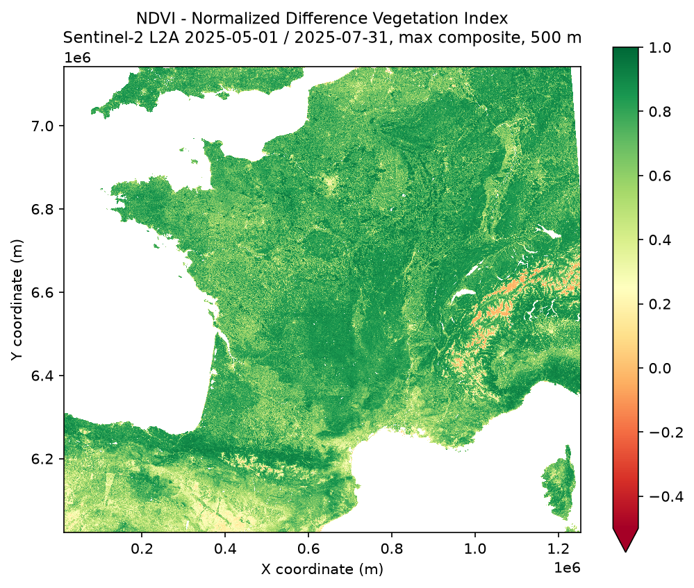
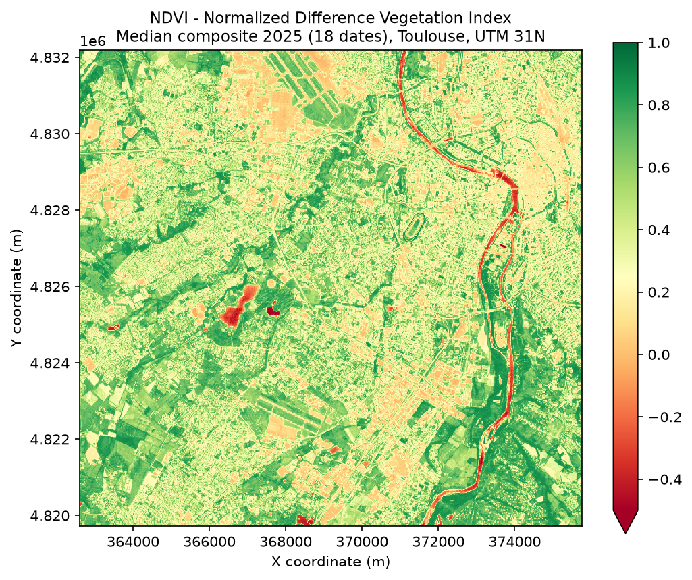
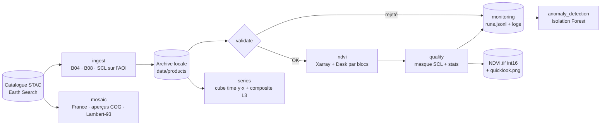
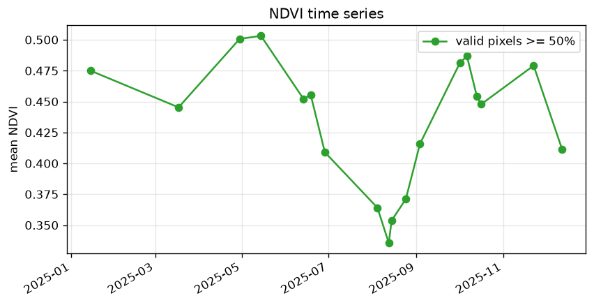
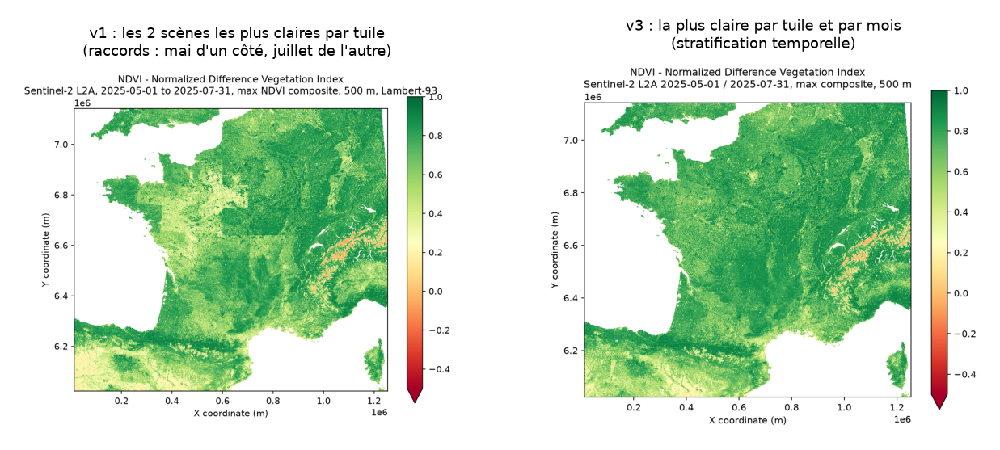
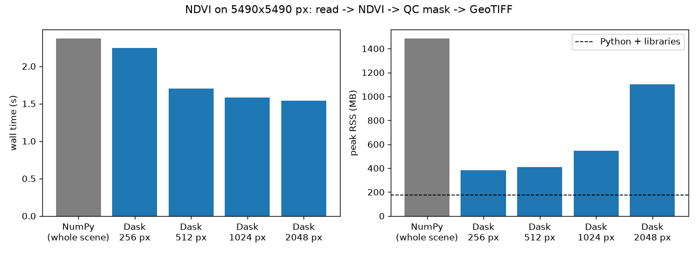

# Earth-ops — mini segment sol Copernicus

**Sentinel-2 L2A · Python · Xarray · Dask · scikit-learn · pratiques inspirées ECSS**

Une chaîne de traitement d'observation de la Terre construite comme un petit segment sol :
elle **ingère** des produits Sentinel-2, les **valide**, calcule un **NDVI** (indice de végétation)
par blocs avec Xarray/Dask, **contrôle la qualité** des produits, **supervise** chaque exécution
(logs + KPI) et **détecte les exécutions atypiques** avec une Isolation Forest.



*NDVI de la France métropolitaine, mai-juillet 2025 : composite de valeur maximale de Sentinel-2
L2A, 500 m, Lambert-93, construit en quelques minutes en lisant uniquement les aperçus des COG.*



*Zoom à 10 m : composite NDVI médian 2025 sans nuages sur le sud-ouest de Toulouse (tuile 31TCJ,
18 dates). On y voit la Garonne, le centre-ville, l'hippodrome de La Cépière et le parcellaire.*

---

## Architecture



| Module | Rôle |
|---|---|
| [`ingest.py`](earth_ops/ingest.py) | Recherche STAC, lecture HTTP fenêtrée des COG (seule l'AOI est téléchargée), SCL rééchantillonnée de 20 à 10 m |
| [`validate.py`](earth_ops/validate.py) | Fichiers, métadonnées, grilles, types, nodata, cohérence radiométrique → codes d'erreur stables |
| [`ndvi.py`](earth_ops/ndvi.py) | NDVI avec Xarray ; `chunks=None` en mémoire, `chunks=1024` par blocs Dask ; séries `(time, y, x)` |
| [`quality.py`](earth_ops/quality.py) | Masque nuages/ombres (SCL), statistiques, statut `NOMINAL` / `DEGRADED` |
| [`pipeline.py`](earth_ops/pipeline.py) | Orchestration, gestion d'erreurs, écriture atomique, un seul graphe Dask pour produit + stats |
| [`monitoring.py`](earth_ops/monitoring.py) | Durée de chaque étape, un enregistrement KPI par exécution (JSON Lines) |
| [`anomaly_detection.py`](earth_ops/anomaly_detection.py) | Isolation Forest sur l'historique des KPI |
| [`mosaic.py`](earth_ops/mosaic.py) | Mosaïque nationale : scène la plus claire par tuile et par mois, aperçus COG, reprojection Lambert-93, composite de valeur maximale, 8 lectures en parallèle |
| [`benchmark.py`](earth_ops/benchmark.py) | NumPy (scène entière) vs Dask (4 tailles de blocs) : temps, mémoire, débit, exactitude |
| [`synthetic.py`](earth_ops/synthetic.py) | Simulateur de produits pour tests reproductibles et injection de pannes |

## Le segment sol en 5 minutes

Un satellite d'observation, c'est le **segment spatial**. Tout ce qui, au sol, transforme ses
données en information utilisable est le **segment sol**. Pour Copernicus, la partie « données »
s'appelle le PDGS (*Payload Data Ground Segment*). Ce projet en reproduit les fonctions en miniature :

| Fonction du segment sol | Ce que ça veut dire | Dans ce projet |
|---|---|---|
| **Acquisition / ingestion** | Récupérer les produits (stations de réception, puis hubs de distribution) | `ingest` depuis un catalogue STAC public, sans compte |
| **Niveaux de produits** | L0 brut → L1C réflectance au sommet de l'atmosphère → **L2A** réflectance de surface + carte de scène (SCL) → L3 produits agrégés | Entrée : L2A. Sorties : NDVI (dérivé L2) et composite médian (type L3) |
| **Contrôle qualité** | Ne jamais livrer un produit faux ; dire *pourquoi* il est rejeté | `validate` (codes `E_*`) + `quality` (statuts) |
| **Archivage** | Stocker de façon fiable, sans doublons ni produits incomplets | Ingestion idempotente, `metadata.json` écrit en dernier, produit renommé seulement s'il est complet |
| **Exploitation** | Des opérateurs suivent des procédures et réagissent aux codes d'erreur | [Manuel d'exploitation](docs/SUM.md), codes retour CLI |
| **Supervision (monitoring)** | Mesurer en continu la santé de la chaîne (durées, débits, taux de rejet) | KPI JSONL + Isolation Forest |
| **Ingénierie logicielle spatiale** | Exigences numérotées → tests → rapport de validation (normes ECSS) | [SRS](docs/SRS.md) → tests `test_req_*` → [SVR](docs/SVR.md) |

## Résultats

### 1. Exploitation sur données réelles : Toulouse, 2025

20 produits Sentinel-2 L2A (tuile 31TCJ, ≤ 30 % de nuages, répartis sur l'année), emprise
13 × 12 km (1316 × 1247 px), ingérés en 77 s (100 Mo).

| Événement | Résultat |
|---|---|
| Traitement des 20 produits | 18 `NOMINAL`, 2 `REJECTED` (`E_RADIOMETRY`, voir l'incident ci-dessous) |
| Pannes injectées (bande manquante, SCL corrompue) | `E_MISSING_FILE`, `E_CORRUPT`, code retour 1 |
| Exécution mal configurée (blocs Dask de 32 px) | 8,5 s au lieu de ≈ 0,2 s → **classée n°1 par l'Isolation Forest** |
| Relance de l'ingestion | 20 produits ignorés (déjà archivés), 0 octet téléchargé |



Le cycle agricole du Sud-Ouest est visible : pic au printemps (céréales), creux en août
(moissons, sécheresse estivale), reprise à l'automne.

### 2. L'incident qui a le plus appris : un offset radiométrique

Au premier traitement, **15 scènes sur 20 sortaient `DEGRADED`**, y compris des scènes à 0 % de
nuages. Les KPI montraient une réflectance rouge médiane de **−0,03** : physiquement impossible.

- **Cause** : le catalogue annonce `offset = -0.1` (convention de la baseline 04.00 de l'ESA),
  alors que cet offset a **déjà été retiré** des données (`earthsearch:boa_offset_applied: true`).
  Appliqué deux fois, il biaise tout le NDVI.
- **Correction** : l'ingestion lit ce drapeau. Surtout, la validation contrôle maintenant la
  plausibilité physique (`E_RADIOMETRY`, réflectance médiane < 0), une nouvelle exigence
  [REQ-VAL-08](docs/SRS.md).
- **Ce que ce contrôle a attrapé ensuite** : 2 produits Sentinel-2C de février-mars 2025 dont le
  drapeau du fournisseur est lui aussi faux. Ils sont rejetés au lieu d'être livrés faux.

Leçon de segment sol : valider le *format* ne suffit pas, il faut valider la *physique*.
Et ce sont les KPI de supervision qui ont révélé l'erreur, pas les tests.

### 3. Passage à l'échelle : la France entière

`python -m earth_ops mosaic` assemble 510 scènes (170 tuiles MGRS, mai-juillet 2025) en
8 min 45 s sur un portable, sans rien stocker d'autre que la carte finale (2483 × 2239 px à
500 m, 6,6 Mo). Trois choix de segment sol :

- **Lire les aperçus des COG** au lieu des tuiles complètes : quelques centaines de ko par bande
  au lieu d'environ 200 Mo.
- **Composite de valeur maximale** (la méthode des synthèses NDVI MODIS) : les nuages font baisser
  le NDVI, donc garder le maximum par pixel privilégie les observations claires.
- **Stratification temporelle** : la première version gardait les 2 scènes les moins nuageuses de
  chaque tuile, et des carrés apparaissaient aux limites de tuiles (mai d'un côté, juillet après
  moisson de l'autre). Garder la scène la plus claire *de chaque mois* les fait disparaître.



### 4. Benchmark HPC : NumPy vs Xarray + Dask

Même traitement (lecture → NDVI → masque qualité → GeoTIFF) sur une scène de 5490 × 5490 px
(¼ de tuile Sentinel-2, 30 Mpx), médiane de 3 répétitions, Apple M3 8 cœurs, ordonnanceur Dask local.



| Méthode | Bloc | Temps (s) | Mémoire crête (Mo) | Débit (Mpx/s) | Écart NDVI max |
|---|---|---|---|---|---|
| NumPy | scène entière | 2,37 | 1 484 | 12,7 | référence |
| Dask | 256 px | 2,24 | 382 | 13,4 | 0 |
| Dask | 512 px | 1,71 | 409 | 17,7 | 0 |
| Dask | 1024 px | 1,58 | 546 | 19,0 | 0 |
| Dask | 2048 px | 1,54 | 1 100 | 19,5 | 0 |

- **Mémoire** : les petits blocs divisent la mémoire crête par 3,9 (256 px). Hors interpréteur
  et bibliothèques (174 Mo), c'est 1 310 Mo contre 208 Mo.
- **Temps** : les petits blocs coûtent en ordonnancement (256 px ≈ NumPy) ; à partir de 512 px,
  le parallélisme multi-cœur l'emporte (×1,5).
- **Les gros blocs ne sont pas gratuits** : à 2048 px, 8 threads × gros blocs ramènent la
  mémoire à 1,1 Go pour un gain de temps négligeable.
- **Choix retenu : 1024 px**, le meilleur compromis débit/mémoire. Et les deux implémentations,
  indépendantes, produisent des sorties **identiques au bit près**.

L'objectif n'était pas de prouver que Dask est toujours plus rapide, mais de savoir *quand* le
calcul par blocs devient intéressant, et de le mesurer.

## Démarrage rapide

```bash
python3.12 -m venv .venv && .venv/bin/pip install -r requirements-dev.txt
.venv/bin/pytest                                             # 45 tests

# Données réelles (catalogue public, sans compte)
.venv/bin/python -m earth_ops ingest --bbox 1.30 43.52 1.46 43.63 \
    --start 2025-01-01 --end 2025-12-31 --max-cloud 30 --limit 20
.venv/bin/python -m earth_ops run data/products/* --chunks 1024
.venv/bin/python -m earth_ops anomalies
.venv/bin/python -m earth_ops series data/products/*
.venv/bin/python -m earth_ops mosaic                       # France, mai-juillet 2025
.venv/bin/python -m earth_ops benchmark --size 5490

# Sans réseau : produits simulés
.venv/bin/python -m earth_ops simulate --count 10
```

Docker : `docker build -t earth-ops .` puis
`docker run --rm -v "$PWD/data:/app/data" earth-ops run data/products/*`
(Dockerfile fourni mais image pas encore construite ni testée, voir [SVR](docs/SVR.md)).

## Documentation (structure inspirée ECSS-E-ST-40C)

- [SRS](docs/SRS.md) : 37 exigences numérotées, avec leur méthode de vérification
- [SUM](docs/SUM.md) : manuel d'exploitation, statuts, codes d'erreur et actions opérateur
- [SVR](docs/SVR.md) : rapport de validation, matrice de traçabilité, non-conformités

Chaque test automatisé porte l'identifiant de l'exigence qu'il vérifie (`test_req_val_02_...`).

## Limites assumées

- Le projet s'inspire des pratiques ECSS **sans revendiquer de conformité** à la norme.
- Démonstration sur une seule AOI ; pas de comparaison à un NDVI de référence externe (par
  exemple Copernicus Land) : le recoupement NumPy/Dask vérifie la cohérence interne, pas la justesse absolue.
- Benchmark sur une machine, une scène simulée, ordonnanceur Dask local (pas de cluster).
- Isolation Forest sur une vingtaine d'exécutions : c'est un démonstrateur, pas un système de surveillance calibré.
